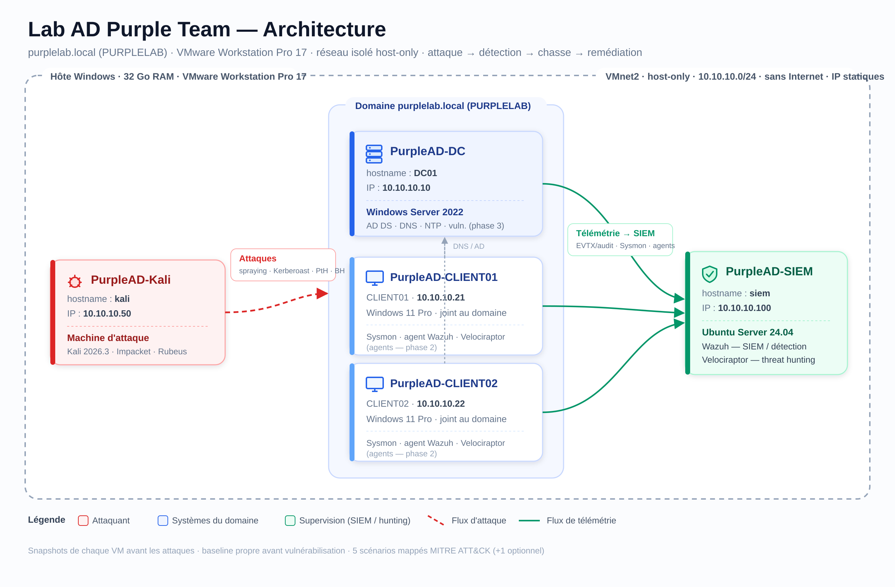

# Lab AD Purple Team

Lab de cybersécurité **Active Directory** orienté **Purple Team** : pour chaque technique d'attaque, on déroule la boucle complète **attaque → détection → chasse → remédiation → rejeu**. Projet unique et documenté, pensé pour le portfolio GitHub et le CV.

> ⚠️ **Lab isolé, usage pédagogique uniquement.** Toutes les attaques sont menées dans un réseau VMware *host-only* fermé, sur des machines volontairement vulnérables. Rien de tout ceci ne doit viser un système réel.

## Architecture



Réseau VMware **host-only** isolé — `10.10.10.0/24`, domaine `purplelab.local`.

| VM        | Rôle                                   | OS                     | IP            |
|-----------|----------------------------------------|------------------------|---------------|
| DC        | AD DS + DNS (volontairement vulnérable)| Windows Server 2022    | 10.10.10.10   |
| CLIENT01  | Poste joint au domaine                 | Windows 11 Pro         | 10.10.10.21   |
| CLIENT02  | Poste joint au domaine                 | Windows 11 Pro         | 10.10.10.22   |
| KALI      | Machine d'attaque                      | Kali Linux             | 10.10.10.50   |
| SIEM      | Wazuh (SIEM) + Velociraptor (hunting)  | Ubuntu Server          | 10.10.10.100  |

Schéma détaillé : `docs/images/architecture.png` — plan complet dans [`docs/00-architecture.md`](docs/00-architecture.md).

## Prérequis

- VMware Workstation Pro
- ISO : Windows Server 2022 (éval), Windows 11 (édition **Pro**, requise pour la jonction au domaine), Kali, Ubuntu Server
- **Snapshot « clean baseline »** de chaque VM avant toute attaque
- Détails d'installation et dimensionnement RAM/CPU : [`docs/01-deploiement-infra.md`](docs/01-deploiement-infra.md)

## Télémétrie activée

Sans ces sources, les attaques sont invisibles dans le SIEM (voir [`docs/02-telemetrie.md`](docs/02-telemetrie.md)) :

- Audit avancé Windows : Kerberos (4768/4769/4771), création de processus (4688), gestion des comptes, logon
- PowerShell Script Block + Module Logging
- Sysmon (config SwiftOnSecurity) sur les postes
- **Vérifier l'ingestion Wazuh de ces trois sources avant de commencer** (étape bloquante)

## Scénarios

Un scénario n'est « fini » que si **la détection se déclenche au rejeu** ET **la remédiation bloque ou limite l'attaque**.

| # | Scénario                              | MITRE ATT&CK | Outil(s)                      | Détection Wazuh | Requête Velociraptor | Règle ajoutée | Remédiation |
|---|---------------------------------------|--------------|-------------------------------|-----------------|----------------------|---------------|-------------|
| 1 | [Password spraying](docs/03-scenarios/01-password-spraying.md) | T1110.003 | CrackMapExec / nxc            | `60122`/`60204` partiels, 4771 non traité | `Custom.PurpleLab.PasswordSpray` | `100101` `100110` `100111` | Verrouillage 5/30 min, longueur 14 + complexité, double reset |
| 2 | [AS-REP roasting](docs/03-scenarios/02-asrep-roasting.md)       | T1558.004 | Impacket GetNPUsers / Rubeus  | aucune native (4768 `preAuthType 0`) | `Custom.PurpleLab.ASREPRoast` | `100120` `100121` | Pré-auth rétablie, double reset, leurre `svc-legacy-backup` |
| 3 | [Kerberoasting](docs/03-scenarios/03-kerberoasting.md)          | T1558.003 | Rubeus / GetUserSPNs          | aucune native (4769 réseau avalé par `92651`) | `Custom.PurpleLab.Kerberoast` | `100130` `100131` `100132` | AES seul + mdp aléatoire 32 car., leurre SPN `svc-mssql-legacy` |
| 4 | [Pass-the-Hash + latéral](docs/03-scenarios/04-pass-the-hash.md)| T1550.002 | Mimikatz + CrackMapExec       | `92652` bruyant, 4698 (atexec) non audité | `Custom.PurpleLab.PassTheHash` | `100140` `100141` `100142` (en cours) | Sysmon ID 10, LAPS, retrait `LocalAccountTokenFilterPolicy` (en cours) |
| 5 | [Chemin → Domain Admin](docs/03-scenarios/05-path-to-da.md)     | T1087     | BloodHound / SharpHound       | _à compléter_ | _à compléter_ | _à compléter_ | Nettoyage ACL, tiering, moindre privilège |

## Structure du dépôt

```
purple-ad-lab/
├── docs/            # architecture, déploiement, télémétrie, scénarios
├── config/          # sysmon, wazuh, velociraptor, gpo (versions ASSAINIES, sans secrets)
├── detection/       # règles Sigma + règles Wazuh dérivées
├── hunting/         # artefacts / requêtes VQL Velociraptor
├── attack/          # commandes d'attaque reproductibles
└── remediation/     # durcissement AD
```

## Avancement

- [x] Infra déployée + snapshots baseline
- [x] DC vulnérabilisé + documenté
- [x] Télémétrie activée et ingestion Wazuh validée
- [x] Wazuh + Velociraptor opérationnels
- [ ] Scénarios 1 → 5 bouclés (3/5 validés au rejeu : 1, 2, 3 ; scénario 4 en cours)
- [ ] README final complété
