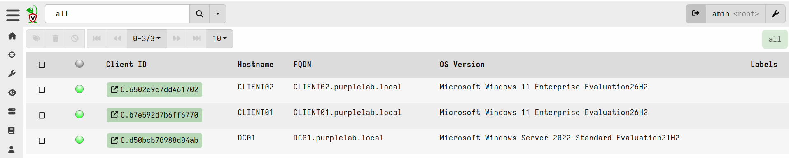
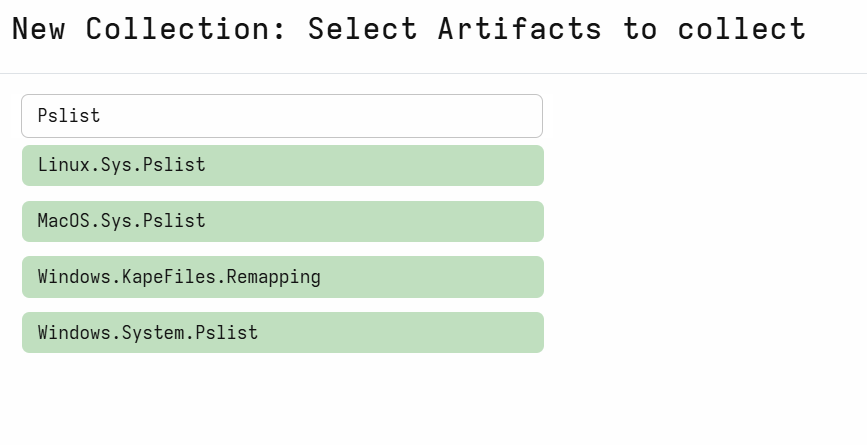
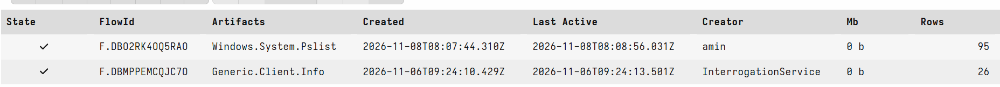
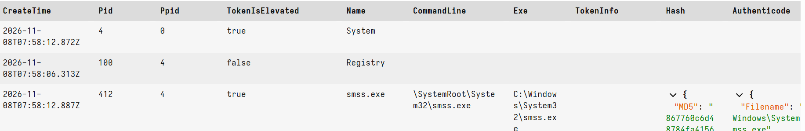
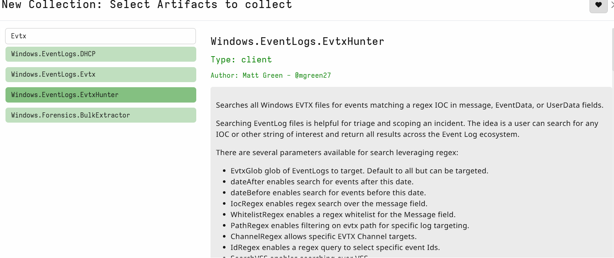
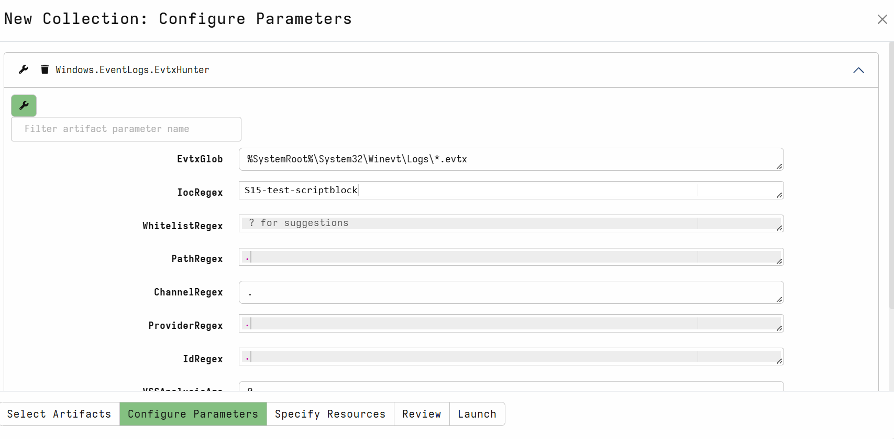
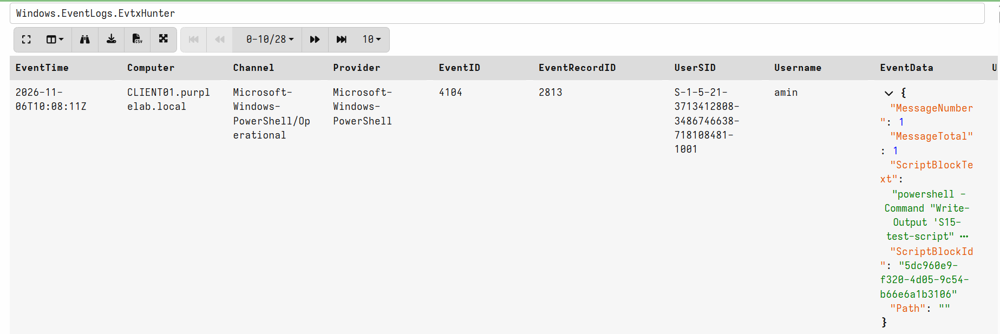

# Télémétrie

Sans ces sources, les attaques AD sont invisibles dans le SIEM.

## 1. Audit avancé Windows (GPO) — ✅ S09 (DC01)
GPO **`PURPLELAB - Audit avance`** créée par [`config/gpo/setup-audit-gpo.ps1`](../config/gpo/setup-audit-gpo.ps1),
liée à la racine du domaine (postes, appliquée à la jonction) et à l'OU `Domain Controllers` (ordre 1).
Détail des sous-catégories : [`config/gpo/audit-policy.md`](../config/gpo/audit-policy.md).

- Connexions : **4624/4625**, 4634, 4672 ; validation NTLM **4776**
- Kerberos : **4768** (TGT), **4769** (TGS), **4771** (échec pré-auth)
- Gestion des comptes / groupes : 4720, 4738, 4740, 4728, 4732, 4756 ; changements AD 5136 (SACL en phase 3)
- Création de processus : **4688** + ligne de commande
- « Force audit policy subcategory settings » activé ; journal Security porté à 512 Mo

**Application (🖥️ PurpleAD-DC, SSH) :**
```powershell
Set-ExecutionPolicy -Scope Process Bypass -Force
C:\Users\Administrateur\setup-audit-gpo.ps1
```

**Validation sur DC01 (2026-11-02) :**
- `auditpol /get /subcategory:{GUID}` → les 11 sous-catégories au réglage attendu ✅
- `klist purge` + `klist get cifs/dc01.purplelab.local` → 4768 et 4769 générés ✅
- 4688 avec ligne de commande (`whoami`) ✅ ; 4624 ✅
- 4771 / 4625 / 4776 : à valider depuis Kali (mauvais mot de passe) lors du contrôle d'ingestion Wazuh ⏳

## 2. PowerShell — ✅ S09 (même GPO)
- Script Block Logging (**4104**) — vérifié sur DC01 ✅
- Module Logging, tous modules `*` (**4103**)
(sur DC et postes, via la GPO ci-dessus)

## 3. Sysmon — ✅ S11 (CLIENT01, CLIENT02)

| Élément | Valeur |
|---|---|
| Binaire | `Sysmon64.exe` 15.22 (Sysinternals), signature Authenticode vérifiée |
| Config | SwiftOnSecurity `sysmonconfig-export.xml`, **non modifiée** — copie figée : [`config/sysmon/`](../config/sysmon/) |
| Emplacement | `C:\Sysmon\` sur chaque poste |
| Journal | `Microsoft-Windows-Sysmon/Operational`, 256 Mo |

**Déploiement (🖥️ Hôte Windows — clients sans Internet, binaire + config téléchargés sur l'hôte) :**
```powershell
foreach ($ip in '10.10.10.21','10.10.10.22') {
  ssh amin@$ip "powershell -NoProfile -Command New-Item -ItemType Directory -Force C:\Sysmon"
  scp .\Sysmon64.exe .\sysmonconfig-export.xml "amin@${ip}:C:/Sysmon/"
  ssh amin@$ip "C:\Sysmon\Sysmon64.exe -accepteula -i C:\Sysmon\sysmonconfig-export.xml"
  ssh amin@$ip "wevtutil sl Microsoft-Windows-Sysmon/Operational /ms:268435456"
}
```

**Validation (2026-11-04, les 2 postes) :** services `Sysmon64` + `SysmonDrv` Running ✅ ; IDs 1, 3, 11, 12, 13, 22 observés ✅ ; taille du journal = 268435456 ✅

**Limite connue :** pas d'ID 10 (ProcessAccess) — bloc vide dans la config SwiftOnSecurity → accès à **LSASS non journalisés**.
Angle mort assumé : traité comme écart de détection dans le scénario 4 (Pass-the-Hash), remédié par une config `sysmonconfig-purplelab.xml`.

**Bruit connu :** ID 8 (CreateRemoteThread) avec `StartFunction: CtrlRoutine` (csrss → console) = gestion de Ctrl+C, bénin.

## 4. Agents : collecte (Wazuh) & endpoint (Velociraptor) — ✅ S14 (DC01, CLIENT01, CLIENT02)
Les sources ci-dessus sont acheminées vers le SIEM par l'**agent Wazuh** (collecte des journaux d'événements → manager, pour corrélation et alerting). Le **client Velociraptor** ajoute un endpoint de *threat hunting* / DFIR interrogeable à la demande depuis le serveur. Serveur : 🖥️ PurpleAD-SIEM (10.10.10.100).

### Agent Wazuh (v4.14.9)
Version alignée sur celle du manager (`/var/ossec/bin/wazuh-control info`). Installation silencieuse par MSI, avec enrôlement automatique auprès du service `authd` (port 1515) ; communication agent↔manager sur le port 1514.

**Déploiement (🖥️ PurpleAD-DC / CLIENT01 / CLIENT02, SSH — `WAZUH_AGENT_NAME` = hostname du poste) :**
```cmd
msiexec /i wazuh-agent-4.14.9-1.msi /qn WAZUH_MANAGER=10.10.10.100 WAZUH_REGISTRATION_SERVER=10.10.10.100 WAZUH_AGENT_NAME=DC01
net start WazuhSvc
```
> `WAZUH_AGENT_NAME` doit être **unique** par poste : un doublon est rejeté par le manager (`Duplicate agent name`), l'agent ne s'enrôle pas. Correctif à chaud : `agent-auth.exe -m 10.10.10.100 -A <nom>` puis `Restart-Service WazuhSvc`.

| Poste | ID agent | Statut |
|---|---|---|
| DC01 | 001 | Active |
| CLIENT01 | 002 | Active |
| CLIENT02 | 003 | Active |

### Client Velociraptor (v0.77.3)
Le binaire Windows est distribué compressé (`velociraptor-v0.77.3-windows-amd64.exe.gz`) : décompression côté hôte, puis déploiement avec le `client.config.yaml` généré par le serveur (`server_urls` → `https://10.10.10.100:8000`).

**Installation en service (🖥️ chaque poste, binaire + config dans `C:\Velociraptor\`) :**
```
velociraptor.exe --config C:\Velociraptor\client.config.yaml service install
```

**Validation S14 (2026-11-06) :**
- **Wazuh** : `sudo /var/ossec/bin/agent_control -l` → DC01, CLIENT01, CLIENT02 `Active` ✅
- **Velociraptor** : console `https://10.10.10.100:8889` → *Search* → les 3 clients en ligne ✅

## 5. Validation de l'ingestion — ✅ S15 (périmètre Windows)

Étape **bloquante** : avant de rendre l'AD vulnérable, on vérifie que la télémétrie remonte réellement dans Wazuh et que Velociraptor peut chasser sur les postes.

**Méthode :** archivage complet temporaire sur le manager (`<logall>` / `<logall_json>` = `yes`) pour capter aussi les events sans règle associée, génération d'événements témoins depuis CLIENT01, puis comptage dans `/var/ossec/logs/archives/archives.json` par Event ID et par agent.

> **Correctif appliqué :** l'agent Wazuh ne collectait au départ que `Application` / `Security` / `System`. Ajout des canaux `Microsoft-Windows-Sysmon/Operational` et `Microsoft-Windows-PowerShell/Operational` dans l'`ossec.conf` des clients, sinon les 4104 et les events Sysmon ne remontent pas.

### Résultat Wazuh

| Source | Event ID | Agent | Archives |
|---|---|---|---|
| Kerberos — demande de TGT | 4768 | DC01 (001) | ✅ |
| Kerberos — ticket de service | 4769 | DC01 (001) | ✅ |
| Création de processus (cmdline) | 4688 | CLIENT01 (002) | ✅ |
| PowerShell Script Block | 4104 | CLIENT01 (002) | ✅ |
| Sysmon — création de processus | 1 | CLIENT01 (002) | ✅ |
| Sysmon — connexion réseau | 3 | CLIENT01 (002) | ✅ |

Pour générer 4768/4769 depuis un poste en session SSH : `net use \\dc01.purplelab.local\SYSVOL /user:PURPLELAB\Administrateur *` (authentifie dans la session courante ; `runas /netonly` ouvre une fenêtre invisible en SSH).

### Validation Velociraptor

Les trois endpoints sont en ligne (DC01, CLIENT01, CLIENT02).



**Preuve de vie — `Windows.System.Pslist` sur CLIENT01** : la collecte se termine et renvoie la liste des processus.





**Chasse sur une trace semée — `Windows.EventLogs.EvtxHunter`**, `IocRegex = S15-test-scriptblock` (chaîne émise par le bloc PowerShell témoin) : l'event **4104** (`PowerShell/Operational`, CLIENT01) est retrouvé → boucle collecte → chasse validée de bout en bout.





### Validation depuis Kali (événements d'attaque)

Une fois Kali installée (10.10.10.50), génération d'échecs d'authentification contre le DC pour vérifier l'ingestion des événements Kerberos / NTLM :

```bash
# 4625 + 4776 — NTLM, utilisateur inexistant (aucun compte réel à verrouiller)
nxc smb 10.10.10.10 -u pentest_fake -p 'Wrong123!'
# 4771 — échec de pré-auth Kerberos sur un compte réel (une tentative)
impacket-getTGT purplelab.local/Administrateur:'Wrong123!' -dc-ip 10.10.10.10
```

| Source | Event ID | Agent | Archives |
|---|---|---|---|
| Échec d'ouverture de session | 4625 | DC01 (001) | ✅ |
| Échec de pré-auth Kerberos | 4771 | DC01 (001) | ✅ |
| Validation d'identifiants NTLM | 4776 | DC01 (001) | ✅ |

Les six sources Windows + ces trois événements d'attaque confirment la chaîne de bout en bout. **S15 est complet.**

### Reste
- Canaux Sysmon / PowerShell à ajouter aussi sur **CLIENT02** (faits sur CLIENT01).
