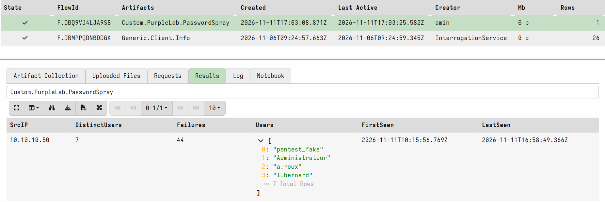
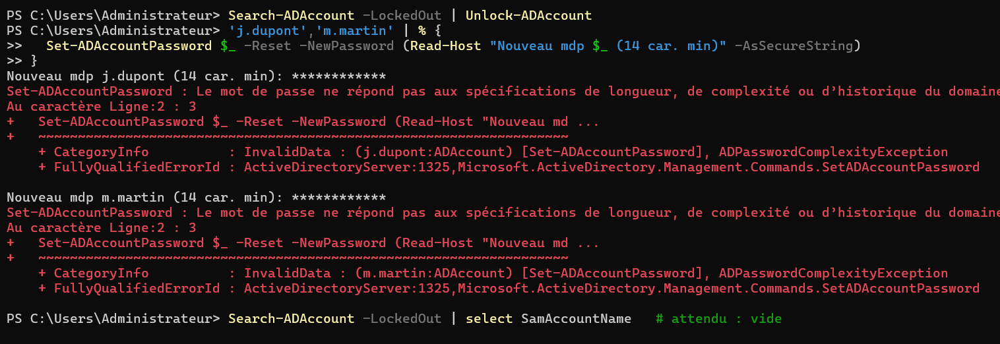
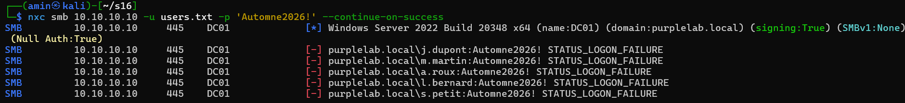

# Scénario 1 — Password spraying (T1110.003)

| | |
|---|---|
| **Technique** | MITRE ATT&CK [T1110.003 — Brute Force: Password Spraying](https://attack.mitre.org/techniques/T1110/003/) |
| **Outil** | NetExec (`nxc`, successeur de CrackMapExec) |
| **Source → cible** | Kali `10.10.10.50` → DC01 `10.10.10.10` |
| **Faiblesse exploitée** | Mot de passe saisonnier `Automne2026!` partagé par `j.dupont` et `m.martin`, aucun verrouillage de compte (`LockoutThreshold 0`) |
| **Date** | 2026-11-11 (ticket Plane S16) |
| **État** | ✅ Terminé : détection déclenchée au rejeu **et** attaque bloquée |

## Résumé

Un attaquant sans identifiant teste **un seul mot de passe sur plusieurs comptes**, pour rester sous les seuils de détection par compte. Dans le lab, une passe de 5 tentatives suffit à compromettre 2 comptes. Wazuh voit chaque échec mais ne qualifie pas l'attaque, et la variante Kerberos passe totalement sous le radar. Deux règles de corrélation et un durcissement de la politique de mots de passe corrigent les deux écarts.

---

## 1. Attaque

🖥️ **PurpleAD-Kali**

```bash
mkdir -p ~/s16 && cd ~/s16
printf '%s\n' j.dupont m.martin a.roux l.bernard s.petit > users.txt

# Variante NTLM (-> 4625 + 4776 sur le DC)
nxc smb 10.10.10.10 -u users.txt -p 'Automne2026!' --continue-on-success

# Variante Kerberos (-> 4771 sur le DC)
nxc smb dc01.purplelab.local -u users.txt -p 'Automne2026!' -k --continue-on-success

# Low and slow : un mot de passe par tour, pause entre les tours
for p in 'Hiver2026!' 'Ete2026!' 'Automne2026!'; do
  nxc smb 10.10.10.10 -u users.txt -p "$p" --continue-on-success
  sleep 60
done
```

**Résultat :** `[+]` sur `j.dupont` et `m.martin`, en NTLM comme en Kerberos.


**Observation annexe :** en mode Kerberos, `nxc` signale `a.roux account vulnerable to asreproast attack`. Le compte n'exige pas de pré-authentification : le DC ne journalise donc aucun 4771 pour lui. C'est la faiblesse exploitée au [scénario 2](02-asrep-roasting.md).

---

## 2. Détection Wazuh (avant remédiation)

| Événement | Règle native | Niveau | Verdict |
|---|---|---|---|
| 4625 (échec NTLM) | `60122` Logon Failure | 5 | Vu, mais unitairement, noyé parmi des centaines de logons réussis |
| Rafale de 4625 | `60204` Multiple Windows Logon Failures | 10 | Une seule alerte, déclenchée par le volume cumulé. Ne dit ni « comptes distincts » ni T1110.003 |
| 4771 (pré-auth Kerberos échouée) | `60104` Windows audit failure event | 5 | **Angle mort** : aucune règle native ne traite le 4771, il tombe dans le générique |
| 4776 (validation NTLM) | `60104` | 5 | Idem, générique |
| 4624 réussi depuis Kali | `92652` | 6 | Vu, mais étiqueté « possible pass-the-hash » et non relié aux échecs |

Comptage des alertes sur le SIEM après l'attaque :

```text
      1 "rule":{"level":10,"description":"Multiple Windows Logon Failures","id":"60204"
     12 "rule":{"level":5,"description":"Logon Failure - Unknown user or bad password","id":"60122"
     12 "rule":{"level":5,"description":"Windows audit failure event","id":"60104"
      1 "rule":{"level":6,"description":"Successful Remote Logon Detected - User:\\j.dupont - NTLM authentication, possible pass-the-hash attack.","id":"92652"
      1 "rule":{"level":6,"description":"Successful Remote Logon Detected - User:\\m.martin - NTLM authentication, possible pass-the-hash attack.","id":"92652"
```

**Pourquoi Wazuh rate l'attaque :** les règles natives comptent des échecs **par source**. La signature du spraying est le nombre de **comptes distincts** visés par une même source. Une passe unique (3 échecs) reste sous le seuil de `60204`, et la variante Kerberos n'est corrélée par rien.

---

## 3. Chasse Velociraptor

**Hypothèse :** une même adresse IP a échoué à s'authentifier sur au moins 4 comptes distincts du domaine ; les traces sont dans le journal Security du DC (4625 et 4771).

**Artefact :** [`hunting/velociraptor/Custom.PurpleLab.PasswordSpray.yaml`](../../hunting/velociraptor/Custom.PurpleLab.PasswordSpray.yaml), collecté sur DC01.

**Résultat :**

| SrcIP | DistinctUsers | Failures | FirstSeen (UTC) | LastSeen (UTC) |
|---|---|---|---|---|
| 10.10.10.50 | 7 | 44 | 2026-11-11 10:15:56 | 2026-11-11 16:58:49 |

Les 7 comptes sont les 5 cibles du spray, plus `pentest_fake` et `Administrateur`, issus des tests d'ingestion du matin (S15) depuis la même machine. L'hypothèse est confirmée : une seule source, plusieurs comptes.



**Pivot possible :** rechercher les 4624 de type 3 depuis `10.10.10.50` dans la même fenêtre pour lister les comptes effectivement compromis.

---

## 4. Remédiation

### 4.1 Règles de détection

- Wazuh : [`detection/wazuh-rules/password-spraying.xml`](../../detection/wazuh-rules/password-spraying.xml) (déployé dans `/var/ossec/etc/rules/local_rules.xml`)
- Sigma : [`detection/sigma/password-spraying.yml`](../../detection/sigma/password-spraying.yml)

| Règle | Logique | Niveau |
|---|---|---|
| `100110` | 3 × 4625 (`60122`) en 5 min, même IP, comptes différents | 12 |
| `100101` | 4771 avec `status` `0x18` (mauvais mot de passe) ou `0x12` (compte verrouillé) | 5 |
| `100111` | 2 × `100101` en 5 min, même IP, comptes différents | 12 |

> **Seuils calibrés pour un lab de 5 comptes.** En production, viser 10 à 20 comptes distincts pour limiter les faux positifs (NAT, proxy d'authentification, serveur applicatif).

### 4.2 Durcissement AD

🖥️ **PurpleAD-DC**

```powershell
Set-ADDefaultDomainPasswordPolicy -Identity purplelab.local `
  -LockoutThreshold 5 -LockoutDuration 00:30:00 -LockoutObservationWindow 00:30:00 `
  -MinPasswordLength 14 -ComplexityEnabled $true

# Réinitialisation des comptes compromis (mot de passe aléatoire)
'j.dupont','m.martin' | % {
  $p = -join ((48..57 + 65..90 + 97..122 | Get-Random -Count 20 | % {[char]$_})) + '!9aZ'
  Set-ADAccountPassword $_ -Reset -NewPassword (ConvertTo-SecureString $p -AsPlainText -Force)
}
```

La nouvelle politique s'applique immédiatement : un mot de passe de 12 caractères est refusé lors de la réinitialisation.



- Le **verrouillage** limite l'attaque (4 essais par compte et par 30 min restent possibles).
- La **fin des mots de passe faibles** est ce qui la bloque.

---

## 5. Rejeu

🖥️ **PurpleAD-Kali** : mêmes commandes qu'à l'étape 1.

| Critère | Preuve | État |
|---|---|---|
| Détection NTLM | `100110`, niveau 12, à 17:52:44 | ✅ |
| Détection Kerberos | `100101` puis `100111` × 3, de 17:52:59 à 17:53:01 | ✅ |
| Blocage | 5 × `STATUS_LOGON_FAILURE` en NTLM, `KDC_ERR_PREAUTH_FAILED` en Kerberos, aucun `[+]` avec `Automne2026!` | ✅ |

Alertes Kerberos sur le SIEM (heure, règle, compte, `status`) : les 4771 antérieurs restent en `60104`, ceux du rejeu passent en `100101` puis `100111`.

```text
17:44:50 60104  l.bernard 0x12
17:44:50 60104  s.petit   0x12
17:52:59 100101 j.dupont  0x18
17:52:59 100111 m.martin  0x18
17:53:01 100111 l.bernard 0x18
17:53:01 100111 s.petit   0x18
```



---

## Enseignements

1. **`0x18` ≠ `0x12`.** Un 4771 porte `0x18` pour un mauvais mot de passe et `0x12` (`KDC_ERR_CLIENT_REVOKED`) pour un compte verrouillé ou désactivé. Une règle limitée à `0x18` devient aveugle dès que le spray verrouille ses cibles. La règle `100101` accepte les deux.
2. **Le verrouillage a un coût.** Pendant les tests, `l.bernard` et `s.petit` (comptes légitimes, jamais compromis) ont été verrouillés par l'attaquant. Le verrouillage seul transforme le spraying en déni de service ; il doit s'accompagner d'une détection et de mots de passe robustes.
3. **Réinitialiser un mot de passe ne coupe pas l'accès NTLM immédiatement.** Juste après la réinitialisation, `Automne2026!` était refusé en Kerberos mais **encore accepté en NTLM** (capture ci-dessous). Ce comportement est cohérent avec la tolérance Windows sur le mot de passe précédent (n-1) en authentification NTLM réseau (`OldPasswordAllowedPeriod`, 60 min par défaut). Une **seconde réinitialisation** a fait sortir l'ancien mot de passe de cette fenêtre. En réponse à incident : réinitialiser deux fois un compte compromis.
4. **Kerberos est l'angle mort natif de Wazuh** pour cette technique : aucun 4771 n'est corrélé sans règle personnalisée.


## Limites

- Détection par fenêtre de 5 min : un spray très lent (un essai par compte toutes les 10 min) passe dessous. Piste : corrélation longue durée côté indexer.
- Seuils bas, adaptés au lab uniquement.
- Les 4768 en échec (`0x6`, compte inexistant) ne sont pas couverts : une énumération d'utilisateurs Kerberos reste hors périmètre.
