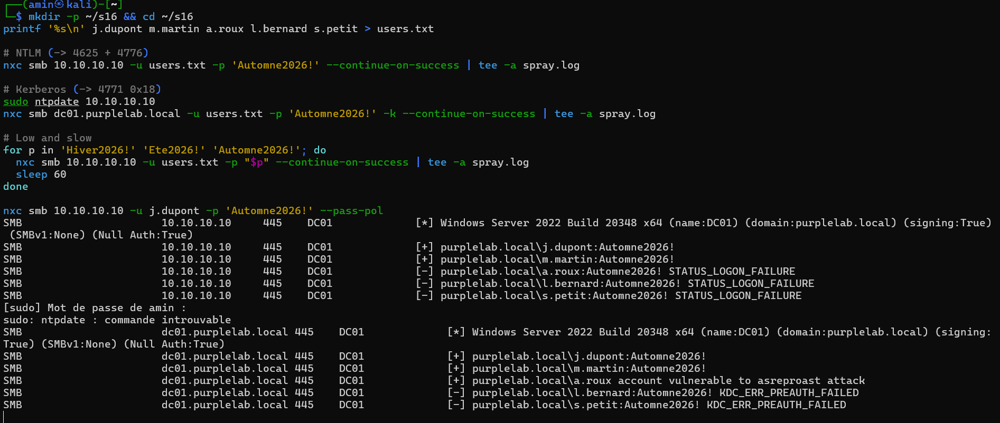
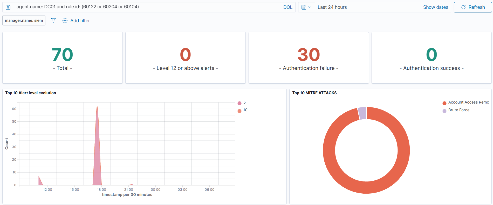
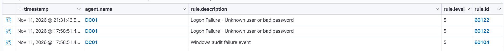
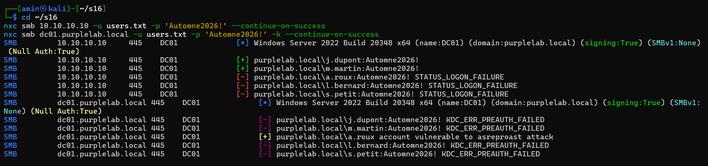
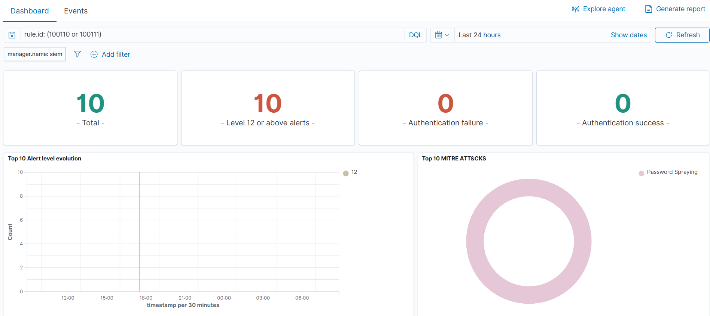
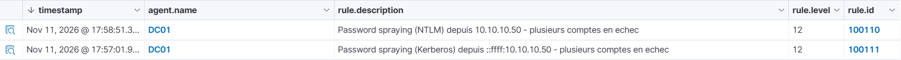
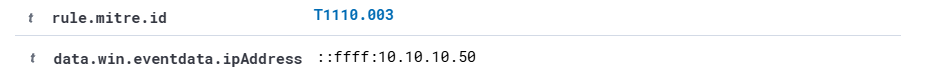

# Scénario 1 : password spraying (T1110.003)

Premier scénario du lab. L'attaque part de Kali (10.10.10.50) et vise le contrôleur de domaine DC01 (10.10.10.10) avec NetExec (`nxc`). Référence MITRE ATT&CK : [T1110.003, Password Spraying](https://attack.mitre.org/techniques/T1110/003/).

## Le principe

Au lieu de tester beaucoup de mots de passe sur un compte, on teste un seul mot de passe sur beaucoup de comptes. Chaque compte ne reçoit qu'une tentative, donc aucun ne se verrouille et les détections qui comptent les échecs par compte ne voient rien.

## La faiblesse dans le lab

Deux utilisateurs, `j.dupont` et `m.martin`, ont le même mot de passe saisonnier, `Automne2026!`, et le domaine n'a aucun verrouillage de compte (`LockoutThreshold` à 0). Les comptes `l.bernard` et `s.petit` ont un mot de passe fort et servent de leurres. `a.roux` est réservé au scénario 2.

## Attaque

Sur Kali, je prépare la liste des comptes puis je lance le même mot de passe sur tous, d'abord en NTLM, ensuite en Kerberos :

```bash
mkdir -p ~/s16 && cd ~/s16
printf '%s\n' j.dupont m.martin a.roux l.bernard s.petit > users.txt

# NTLM
nxc smb 10.10.10.10 -u users.txt -p 'Automne2026!' --continue-on-success

# Kerberos
nxc smb dc01.purplelab.local -u users.txt -p 'Automne2026!' -k --continue-on-success
```

J'ai aussi testé une version plus lente, avec un mot de passe par tour et une minute de pause entre les tours :

```bash
for p in 'Hiver2026!' 'Ete2026!' 'Automne2026!'; do
  nxc smb 10.10.10.10 -u users.txt -p "$p" --continue-on-success
  sleep 60
done
```

Cinq tentatives suffisent : `j.dupont` et `m.martin` tombent dans les deux modes.



En Kerberos, `nxc` affiche aussi `a.roux account vulnerable to asreproast attack`. Ce n'est pas une connexion réussie : le compte n'exige pas de pré-authentification, ce qui est la faiblesse du [scénario 2](02-asrep-roasting.md). Conséquence utile à connaître pour la suite : le DC ne journalise aucun événement 4771 pour ce compte.

## Ce que Wazuh a vu

Voici le décompte des alertes sur le SIEM juste après l'attaque :

```text
      1 "rule":{"level":10,"description":"Multiple Windows Logon Failures","id":"60204"
     12 "rule":{"level":5,"description":"Logon Failure - Unknown user or bad password","id":"60122"
     12 "rule":{"level":5,"description":"Windows audit failure event","id":"60104"
      1 "rule":{"level":6,"description":"Successful Remote Logon Detected - User:\\j.dupont - NTLM authentication, possible pass-the-hash attack.","id":"92652"
      1 "rule":{"level":6,"description":"Successful Remote Logon Detected - User:\\m.martin - NTLM authentication, possible pass-the-hash attack.","id":"92652"
```

Le dashboard raconte la même chose. En filtrant sur le DC et sur ces règles, on obtient 70 alertes sur la journée, un pic très net au moment de l'attaque, et aucune alerte de niveau 12 ou plus. Côté MITRE, Wazuh range ça dans « Brute Force » au sens large, sans parler de spraying.



Dans la liste des événements, ce sont des échecs de connexion de niveau 5, un par ligne :



Wazuh n'est pas aveugle, mais il ne comprend pas ce qui se passe.

| Événement Windows | Règle Wazuh | Ce que ça donne |
|---|---|---|
| 4625, échec NTLM | 60122, niveau 5 | Une alerte par échec, noyée dans plusieurs centaines de connexions réussies |
| Rafale de 4625 | 60204, niveau 10 | Une seule alerte, déclenchée par le volume total, sans notion de comptes différents |
| 4771, échec de pré-authentification Kerberos | 60104, niveau 5 | Aucune règle dédiée, l'événement finit dans la règle générique « audit failure » |
| 4624, connexion NTLM réussie | 92652, niveau 6 | Vue, mais étiquetée « possible pass-the-hash » et pas reliée aux échecs |

Le problème de fond est que les règles par défaut comptent les échecs par source, alors que ce qui caractérise un spray est le nombre de comptes différents visés par une même source. Une passe unique ne produit que trois échecs (les deux comptes compromis n'en génèrent pas), ce qui reste sous le seuil de la règle 60204. Et la variante Kerberos n'est corrélée par rien du tout.

## Chasse avec Velociraptor

Mon hypothèse de départ : si quelqu'un a fait du spraying, une même adresse IP a échoué sur plusieurs comptes différents, et la trace est dans le journal Security du DC, dans les événements 4625 et 4771.

J'ai écrit un artefact qui lit ce journal, regroupe les échecs par adresse source et compte les comptes distincts : [`Custom.PurpleLab.PasswordSpray`](../../hunting/velociraptor/Custom.PurpleLab.PasswordSpray.yaml). Il ne remonte que les sources ayant échoué sur au moins 4 comptes.

Collecté sur DC01, il renvoie une seule ligne : 10.10.10.50, 7 comptes distincts, 44 échecs.


Les 7 comptes sont les 5 de ma liste, plus `pentest_fake` et `Administrateur`. Ces deux-là viennent de mes tests d'ingestion du matin, lancés depuis la même Kali. Les heures affichées sont en UTC.

Pour aller plus loin, il suffirait de chercher les connexions réussies (4624, type 3) depuis cette adresse dans la même fenêtre de temps : ce sont les comptes réellement compromis.

## Remédiation

### Règles Wazuh

J'ai ajouté trois règles dans `local_rules.xml` sur le manager. Le fichier est dans le dépôt : [`password-spraying.xml`](../../detection/wazuh-rules/password-spraying.xml). Une version Sigma, indépendante du SIEM, est dans [`password-spraying.yml`](../../detection/sigma/password-spraying.yml).

| Règle | Ce qu'elle fait | Niveau |
|---|---|---|
| 100110 | 3 échecs NTLM (règle 60122) en 5 minutes, depuis la même IP, sur des comptes différents | 12 |
| 100101 | Isole les 4771 dont le code est `0x18` (mauvais mot de passe) ou `0x12` (compte verrouillé) | 5 |
| 100111 | 2 alertes 100101 en 5 minutes, depuis la même IP, sur des comptes différents | 12 |

Les seuils sont volontairement bas parce que le lab n'a que cinq comptes. Sur un vrai domaine, il faudrait viser plutôt 10 à 20 comptes distincts, sinon une passerelle NAT ou un serveur applicatif déclencherait la règle en permanence.

### Durcissement de l'AD

Sur DC01 :

```powershell
Set-ADDefaultDomainPasswordPolicy -Identity purplelab.local `
  -LockoutThreshold 5 -LockoutDuration 00:30:00 -LockoutObservationWindow 00:30:00 `
  -MinPasswordLength 14 -ComplexityEnabled $true
```

Puis réinitialisation des deux comptes compromis avec un mot de passe aléatoire :

```powershell
'j.dupont','m.martin' | % {
  $p = -join ((48..57 + 65..90 + 97..122 | Get-Random -Count 20 | % {[char]$_})) + '!9aZ'
  Set-ADAccountPassword $_ -Reset -NewPassword (ConvertTo-SecureString $p -AsPlainText -Force)
}
```

La politique s'applique tout de suite. À ma première tentative de réinitialisation, j'avais saisi un mot de passe de 12 caractères et le DC l'a refusé :


## Rejeu

J'ai relancé exactement les mêmes commandes. Tout n'a pas marché du premier coup, et c'est la partie la plus instructive du scénario.

### La règle Kerberos qui ne se déclenchait pas

Au premier rejeu, la règle NTLM (100110) s'est déclenchée, mais pas la règle Kerberos. J'ai d'abord cru à une erreur dans la règle. En affichant l'événement brut, j'ai vu que les 4771 portaient le code `0x12` et non `0x18` : j'avais déjà activé le verrouillage, et à force de tests `l.bernard` et `s.petit` étaient verrouillés. Le DC ne répondait plus « mauvais mot de passe » mais « compte révoqué ».

La règle était donc correcte, mais trop étroite. Un spray qui tombe sur des comptes verrouillés reste un spray, donc elle accepte maintenant les deux codes. Après déverrouillage des comptes, les deux détections se déclenchent :

```text
17:44:50 60104  l.bernard 0x12
17:44:50 60104  s.petit   0x12
17:52:59 100101 j.dupont  0x18
17:52:59 100111 m.martin  0x18
17:53:01 100111 l.bernard 0x18
17:53:01 100111 s.petit   0x18
```

Les deux premières lignes sont les événements d'avant la correction, restés dans la règle générique. Les suivantes sont celles du rejeu.

### L'ancien mot de passe encore accepté

Deuxième surprise : juste après la réinitialisation, `Automne2026!` était bien refusé en Kerberos, mais encore accepté en NTLM pour les deux comptes.



Ce comportement correspond à une tolérance de Windows : après un changement, le mot de passe précédent reste utilisable un moment en authentification NTLM réseau (paramètre `OldPasswordAllowedPeriod`, 60 minutes par défaut), pour laisser le temps à la réplication entre contrôleurs de domaine. Je n'ai pas modifié ce paramètre. J'ai simplement réinitialisé les deux comptes une seconde fois, ce qui fait sortir `Automne2026!` de la fenêtre, et le rejeu suivant n'a plus donné aucun succès :


### Bilan

Au rejeu, la règle 100110 s'est déclenchée pour le spray NTLM et la règle 100111 pour le spray Kerberos, toutes deux au niveau 12 avec l'adresse de Kali. Sur l'ensemble des rejeux, le dashboard compte 10 alertes, toutes de niveau 12, et les classe cette fois en « Password Spraying ».





Le détail d'une alerte porte bien l'identifiant MITRE et l'adresse source :



Côté attaquant, plus aucun compte ne répond à `Automne2026!`. La détection fonctionne et l'attaque est bloquée.

## Ce que j'ai appris

Regarder l'événement brut avant de toucher à une règle. J'ai réécrit la règle Kerberos deux fois pour rien avant de lire le champ `status`, qui donnait la réponse tout de suite.

Le verrouillage de compte n'est pas une solution à lui seul. Il limite le nombre d'essais, mais pendant mes tests ce sont deux comptes légitimes, jamais compromis, qui se sont retrouvés bloqués. Un attaquant peut s'en servir pour faire du déni de service. Ce qui arrête vraiment le spraying, c'est l'absence de mots de passe devinables.

Réinitialiser un mot de passe compromis ne coupe pas l'accès immédiatement en NTLM. En réponse à incident, il faut le faire deux fois, ou réduire `OldPasswordAllowedPeriod`.

Kerberos est le point faible de Wazuh sur cette technique : sans règle personnalisée, les 4771 ne sont jamais corrélés.

## Limites

La corrélation se fait sur 5 minutes. Un spray très lent, par exemple un essai par compte toutes les dix minutes, passerait en dessous. Il faudrait une corrélation sur une durée plus longue, côté indexer.

Les règles ne couvrent pas les 4768 en échec avec le code `0x6` (compte inexistant). Une énumération d'utilisateurs par Kerberos n'est donc pas détectée ici.
