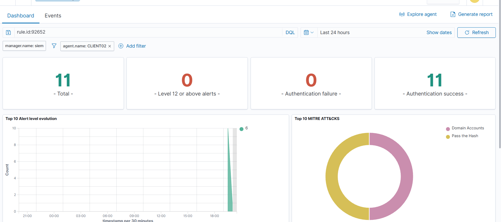
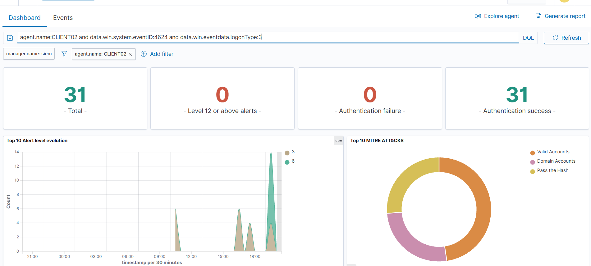
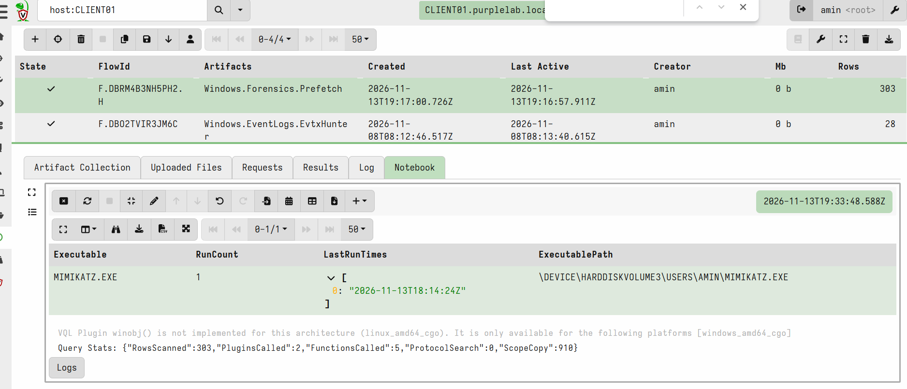
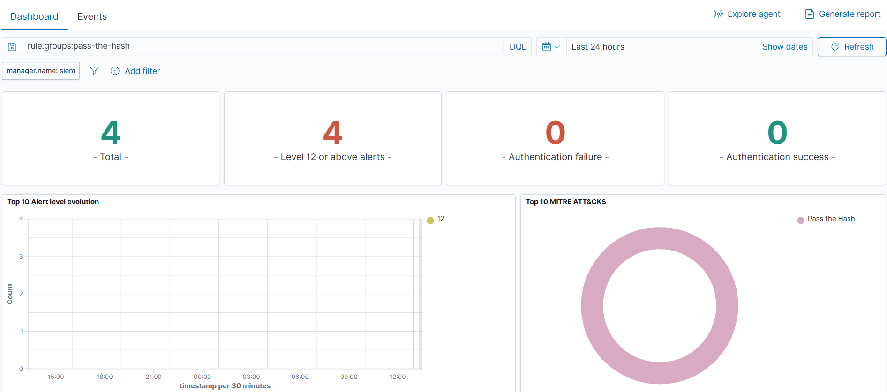
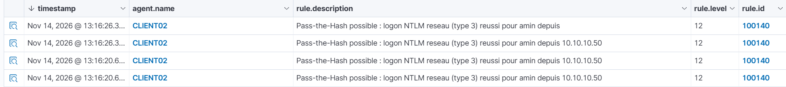

# Scénario 4 : Pass-the-Hash et mouvement latéral

| | |
|---|---|
| Technique | T1550.002, Use Alternate Authentication Material: Pass the Hash |
| Outils | Mimikatz, NetExec (nxc), Velociraptor |
| Source et cible | CLIENT01 (10.10.10.21) et Kali (10.10.10.50) vers CLIENT02 (10.10.10.22) |
| Faiblesse exploitée | Le compte administrateur local `amin` a le même mot de passe sur les deux postes, et `LocalAccountTokenFilterPolicy` ouvre l'exécution à distance |
| Date | 13 et 14 novembre 2026 |
| État | Détection validée au rejeu et attaque bloquée ; règle atexec et Sysmon ID 10 à revalider |

## Résumé

Avec le condensat NTLM d'un compte, pas besoin du mot de passe en clair : on le rejoue directement pour s'authentifier. Depuis CLIENT01, où j'avais les droits d'administrateur local, j'ai lu le SAM avec Mimikatz et récupéré le condensat du compte local `amin`. Ce même compte existe à l'identique sur CLIENT02, donc le condensat y ouvre un accès administrateur complet, et de là une exécution de commandes en tant que `SYSTEM`.

Nativement, Wazuh ne voit qu'un logon NTLM réseau parmi d'autres : la règle `92652` se déclenche sur tous les logons de ce type, en bas niveau, noyée dans le bruit. J'ai ajouté une règle qui remonte un logon NTLM de compte local au niveau 12, ce qui le sort enfin du lot. Côté chasse, Velociraptor a prouvé sur le disque que Mimikatz avait bien tourné, ce que les journaux n'avaient pas su qualifier. La remédiation qui compte n'est pas une règle mais la suppression de la réutilisation : un mot de passe unique par poste, dans l'esprit de LAPS. Au rejeu, l'ancien condensat ne fonctionne plus et la règle `100140` déclenche au niveau 12.

## Préparation

Le scénario touche pour la première fois les deux postes clients, donc j'ai pris un snapshot de CLIENT01 et de CLIENT02 avant de commencer. Le DC était déjà sur sa baseline vulnérable, ce que j'ai vérifié depuis Kali en confirmant qu'un compte faible répondait toujours.

Le point de départ de l'attaque est un poste déjà compromis. Je le simule en travaillant sur CLIENT01 avec le compte administrateur local `amin`, comme si un attaquant y avait pris pied. Mimikatz n'est pas présent dans le lab : Kali l'embarque dans `/usr/share/windows-resources/mimikatz/`, je l'ai donc poussé depuis Kali vers CLIENT01 par scp, en gardant tout dans le réseau isolé plutôt que de le télécharger sur l'hôte managé. Defender a mis le binaire en quarantaine à l'arrivée ; j'ai désactivé la protection en temps réel sur CLIENT01, ce qui est assumé et documenté pour un poste de lab.

## 1. Attaque

Sur CLIENT01, dans une invite administrateur, Mimikatz passe d'abord en `SYSTEM` puis lit le SAM :

```text
mimikatz # privilege::debug
Privilege '20' OK
mimikatz # token::elevate
SID name  : AUTORITE NT\Système
mimikatz # lsadump::sam
RID  : 000003e9 (1001)
User : amin
  Hash NTLM: <masqué>
```

J'ai aussi lancé `sekurlsa::logonpasswords`, qui a échoué avec `Handle on memory (0x00000005)`. Sur Windows 11, l'accès à la mémoire de LSASS est bloqué par défaut, donc le dump classique des sessions ne passe pas. La lecture du SAM, elle, réussit et suffit : elle me donne le condensat du compte local.

Depuis Kali, je cherche d'abord où ce condensat est réutilisé, puis je m'en sers pour exécuter une commande sur CLIENT02 :

```bash
nxc smb 10.10.10.0/24 -u amin -H <NTLM_amin> --local-auth
nxc smb 10.10.10.22 -u amin -H <NTLM_amin> --local-auth -x "whoami" --exec-method atexec
```

Le balayage confirme que CLIENT02 accepte le condensat. La première tentative d'exécution n'a renvoyé qu'un accès valide, sans les droits d'administrateur effectifs : pour un compte local autre que l'Administrateur intégré, le jeton réseau est filtré par le contrôle de compte. En posant `LocalAccountTokenFilterPolicy` à 1 sur CLIENT02, défaut fréquent en entreprise, le Pass-the-Hash devient pleinement exploitable et la commande s'exécute en `autorite nt\système` via une tâche planifiée (atexec).

## 2. Détection Wazuh avant remédiation

Le logon du rejeu du condensat arrive bien sur le SIEM, mais rien ne le fait ressortir. La règle native `92652`, « possible pass-the-hash », se déclenche sur tout logon NTLM réseau réussi : elle est présente mais en bas niveau, et aucun de ces événements n'atteint le niveau 12.





Trois angles morts complètent le tableau. Le mouvement latéral par atexec crée une tâche planifiée, mais l'audit de cet événement (4698) n'est pas activé, donc il reste muet. L'exécution de Mimikatz apparaît bien dans les événements Sysmon de création de processus, mais seulement avec des alertes génériques de bas niveau : rien ne signale un outil de vol d'identifiants. Enfin, l'accès à LSASS n'est pas journalisé, faute d'un Sysmon configuré pour cela, et de toute façon le dump s'est fait ici sur le SAM.

## 3. Chasse Velociraptor

L'hypothèse de chasse découle directement de ces angles morts : un outil de dump a tourné sur CLIENT01, puis son binaire peut être supprimé, et les journaux n'en gardent pas la preuve exploitable. Je cherche donc sur le disque, pas dans les journaux déjà couverts par Wazuh. Le Prefetch garde une trace de chaque exécutable lancé.

J'ai lancé une collecte `Windows.Forensics.Prefetch` et filtré sur le nom de l'outil dans le notebook :

```text
SELECT Executable, RunCount, LastRunTimes, ExecutablePath
FROM source()
WHERE Executable =~ "MIMIKATZ"
```



La ligne montre `MIMIKATZ.EXE`, un nombre d'exécutions et une date qui collent à l'attaque, et le chemin `C:\Users\amin\`. C'est la preuve que Wazuh n'avait pas produite : l'outil a bien tourné sur le poste. Cet artefact est enregistré dans le dépôt sous `hunting/velociraptor/Custom.PurpleLab.PassTheHash.yaml`.

## 4. Remédiation

J'ai ajouté trois règles dans `detection/wazuh-rules/pass-the-hash.xml` : `100140` pour un logon NTLM réseau de type 3 hors compte machine, `100141` pour un accès à la mémoire de LSASS vu par Sysmon, et `100142` pour la création d'une tâche planifiée. Les deux dernières dépendent de télémétrie à activer : l'audit des tâches planifiées, posé avec le GUID de la sous-catégorie pour éviter le nom français, et l'ajout de `ProcessAccess` sur `lsass.exe` dans la configuration Sysmon.

Mais la vraie remédiation est ailleurs. L'attaque ne marche que parce que le compte `amin` a le même condensat sur les deux postes. Le correctif structurel est un mot de passe d'administrateur local unique par machine, ce que LAPS automatise. Je l'ai simulé en changeant le mot de passe de `amin` sur CLIENT02. En complément, `LocalAccountTokenFilterPolicy` est remis à 0, et la protection de LSASS déjà active sur les postes bloque le dump de la mémoire.

## 5. Rejeu

Après avoir chargé les règles sur le SIEM et activé l'audit, j'ai rejoué le logon du condensat depuis Kali. Cette fois la règle `100140` se déclenche, au niveau 12 : le Pass-the-Hash sort enfin du bruit.





Côté blocage, le changement de mot de passe de `amin` sur CLIENT02 a cassé la réutilisation : l'ancien condensat ne donne plus accès, seul le nouveau mot de passe fonctionne. La détection se déclenche et la remédiation bloque, donc le critère du scénario est rempli.

Deux règles restent à revalider. `100142` n'a rien remonté car aucun 4698 n'a été produit malgré l'audit activé, probablement repris par la GPO d'audit avancé posée plus tôt : il faudra l'activer par GPO. `100141` n'a pas pu être démontrée puisque LSASS est protégé et qu'aucun accès réel à sa mémoire n'a eu lieu ; l'ID 10 reste utile pour couvrir une future tentative.

## Ce que j'ai appris

Un logon Pass-the-Hash ressemble à un logon NTLM réseau tout à fait normal. La règle native existe mais crie sur tout, donc la valeur ajoutée n'est pas de détecter le NTLM mais de resserrer : un logon NTLM d'un compte local, remonté au niveau 12, devient un signal exploitable.

La leçon défensive principale n'est pas une règle. Tant que le même compte local existe à l'identique sur tout le parc, un seul poste compromis les ouvre tous. Supprimer la réutilisation, avec un mot de passe unique par machine, casse la technique à la racine, et le rejeu l'a montré directement.

Velociraptor a trouvé ici sa vraie place. Les journaux n'avaient pas qualifié l'exécution de Mimikatz, le Prefetch l'a prouvée. C'est la répartition que je visais : Wazuh pour la détection continue sur les logs, Velociraptor pour ce que les logs n'ont pas.

Enfin, Windows 11 protège LSASS par défaut. Le dump classique des sessions a échoué, et c'est une bonne nouvelle : le chemin le plus connu est déjà fermé sans rien configurer. La lecture du SAM, elle, restait ouverte.

## Limites

L'exécution à distance a nécessité de poser `LocalAccountTokenFilterPolicy` à 1, un défaut volontaire. Sur un poste laissé par défaut, le Pass-the-Hash d'un compte local autre que l'Administrateur intégré aurait été filtré par le contrôle de compte.

La détection du mouvement latéral (tâche planifiée) et celle du dump LSASS ne sont pas encore prouvées au rejeu. La première demande de fiabiliser l'audit par GPO, la seconde un vrai accès à LSASS, par exemple après désactivation temporaire de sa protection, pour vérifier que l'ID 10 et la règle `100141` se déclenchent.
